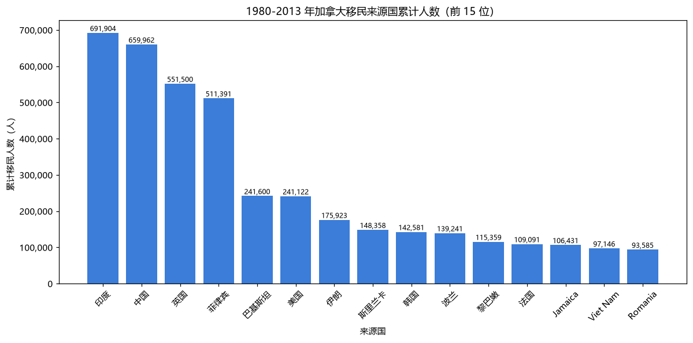
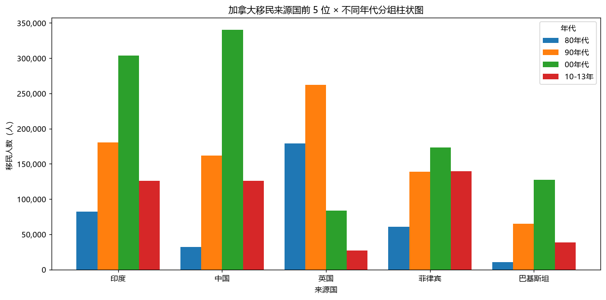
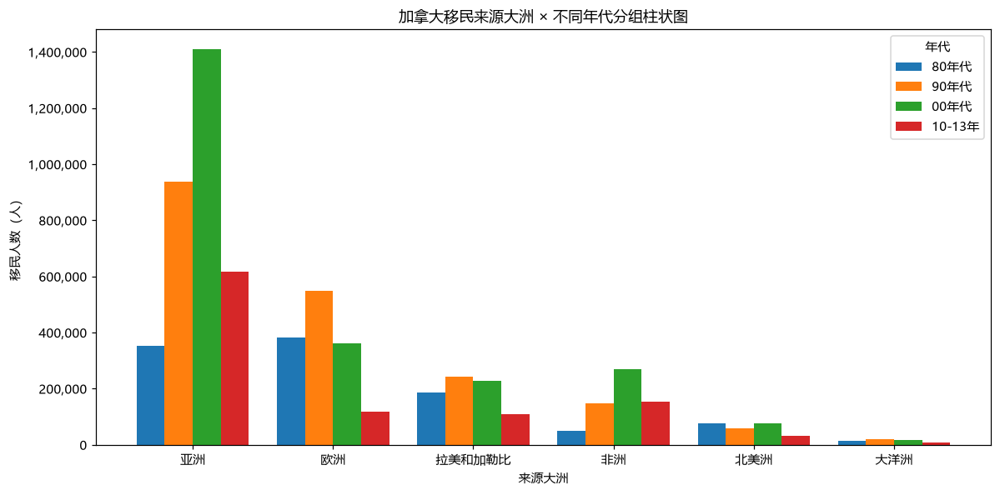
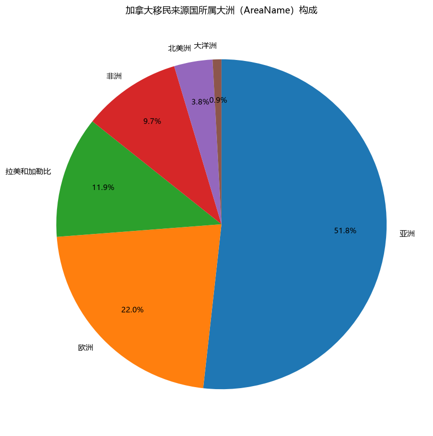
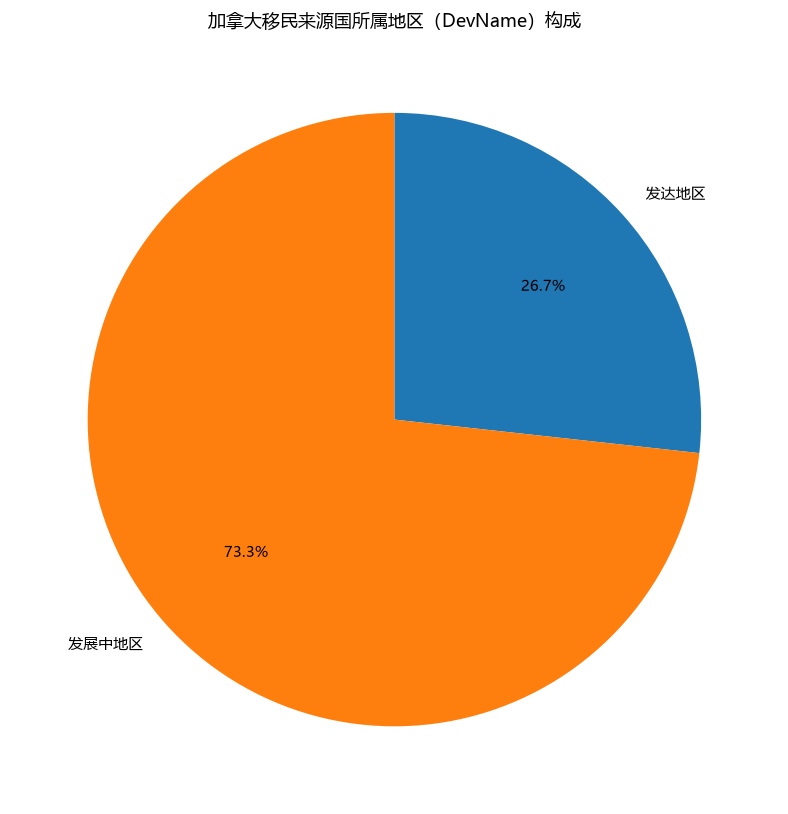
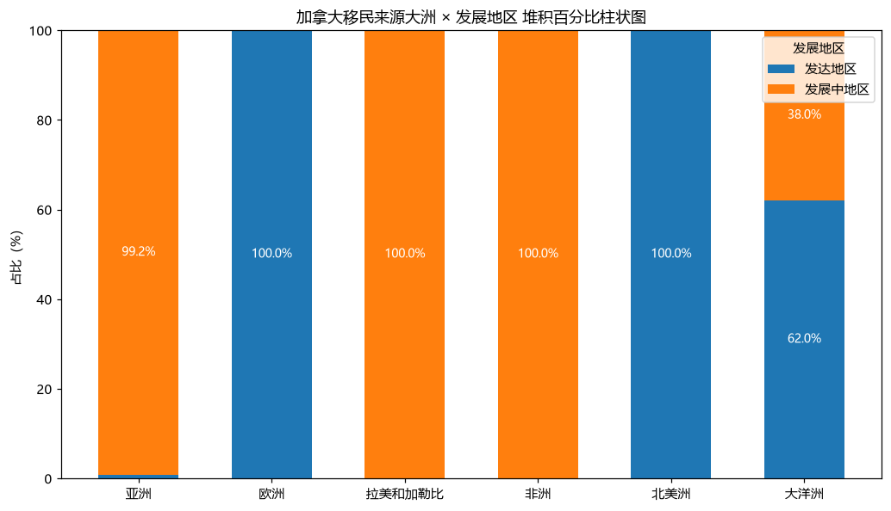
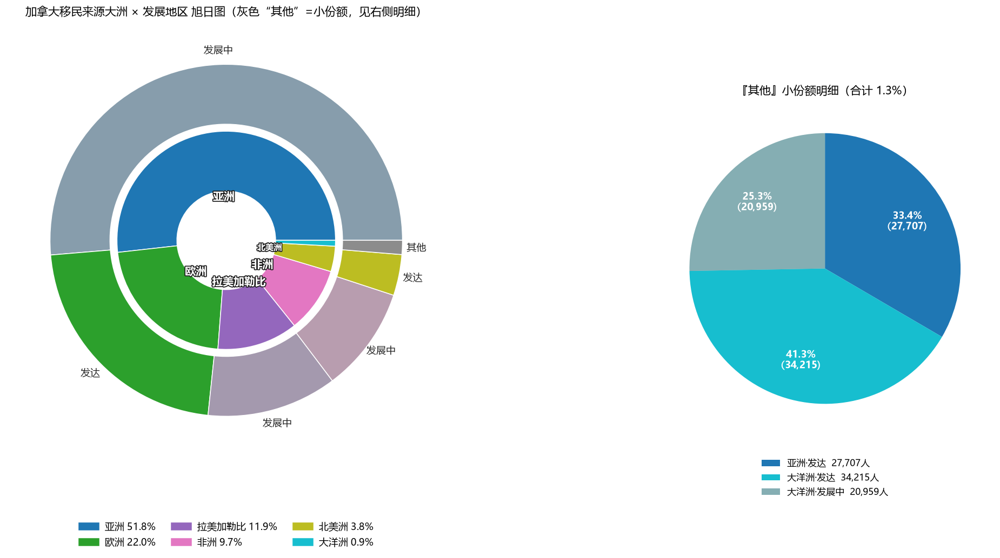
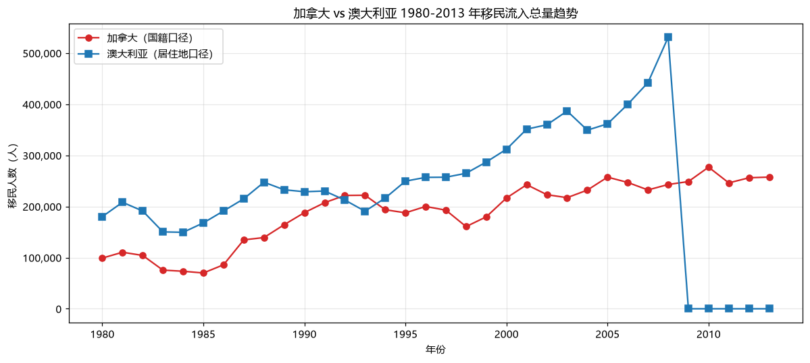
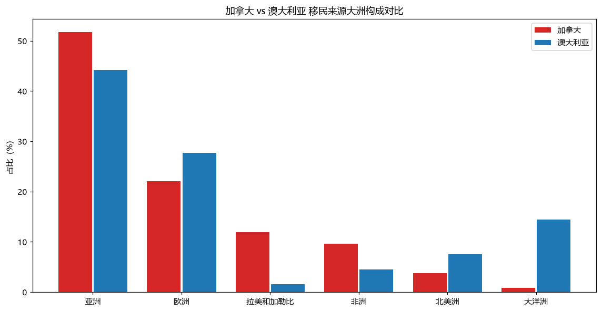

# 实验一：数据获取与整理

## 一、数据获取（1.1）

**数据来源**：联合国经济和社会事务部人口司（United Nations, DESA, Population Division），《International Migration Flows to and from Selected Countries: The 2015 Revision》（数据库编号 POP/DB/MIG/Flow/Rev.2015）。

**数据集概括**：本实验选用其中加拿大（Canada）的国际移民流入数据。数据按"国籍（Citizenship）"口径统计，记录 1980—2013 年（34 年）进入加拿大的外来移民，共覆盖 197 个来源国/地区。

**数据结构**：

| 要素 | 说明 |
| --- | --- |
| 对象（行） | 每一个"来源国/地区"（OdName），共 197 个 |
| 属性（列） | OdName 来源国、AREA/AreaName 大洲、REG/RegName 地区、DEV/DevName 发展地区、1980—2013 各年份移民人数 |
| 结构 | 以"来源国 × 年份"的二维表，可聚合到地区、大洲、发展地区等层级 |

分析口径：`Type = Immigrants`（流入）且 `Coverage = Foreigners`（外来移民），即"外国籍人口流入加拿大"。

## 二、数据整理（1.2）

1. 读取 `Canada.xlsx` 的国家级明细表 `Canada by Citizenship`（表头在第 20 行）。
2. 剔除合计行（`Total`、`Unknown`）与非来源国行。
3. 将年份列统一转为数值，缺失值按 0 处理（本表无缺失）。
4. 按"年代"聚合：80 年代（1980—1989）、90 年代（1990—1999）、00 年代（2000—2009）、10-13 年（2010—2013）。

## 三、提炼可视化分析问题（1.3）

聚焦**微观层次（单一国家）**：以加拿大为目的地国，分析 1980—2013 年移民的来源结构——谁在移民加拿大？主要来自哪些国家、大洲、发展地区？结构随时间如何变化？

---

## 四、任务 1：来源国柱状图（1.4）

**图形选择与要素**：采用竖直柱状图，类别为来源国、数值为 1980—2013 年累计移民人数，仅保留前 15 位，柱顶标注具体数值，x 轴国名旋转 45° 避免重叠，y 轴千分位刻度。

**分析**：加拿大移民来源高度集中于少数国家。累计最多的印度（691,904 人）与中国（659,962 人）遥遥领先，其后是英国（551,500 人）、菲律宾（511,391 人）。前 4 国合计约 241 万人，占全部外来移民的很大比重；亚洲国家在前 15 位中占据明显多数，说明亚洲是加拿大移民的最主要来源。

## 五、任务 2：分组柱状图（1.5）

**图形选择**：前 5 位来源国 × 4 个年代的分组柱状图（每组 4 根柱）。

**分析**：各国的时间结构差异明显——
- **印度、中国、巴基斯坦**：80 年代基数较小，之后持续快速上升，00 年代达到高峰，呈现"亚洲新移民快速增长"的轨迹；
- **英国**：80—90 年代是最大来源之一（179,171 人 / 261,966 人），00 年代后大幅萎缩（83,413 人），反映传统欧洲来源的式微；
- **菲律宾**：相对平稳增长，10-13 年（139,241 人）仍保持高位。

**补充图形**：按"大洲 × 年代"分组，展示来源大洲的时间演变。亚洲在每个年代都居首且绝对量不断攀升，欧洲第二但 00 年代后增长乏力，说明加拿大移民"欧洲来源让位于亚洲来源"的结构性转变。

## 六、任务 3：饼图（1.6）

**分析**：按来源国所属大洲（AreaName）看，亚洲占 51.8%（3,317,794 人）居绝对主导，欧洲 22.0%（1,410,947 人）次之，拉美和加勒比 11.9%、非洲 9.7%、北美洲 3.8%、大洋洲 0.9%。饼图优化：降序排列、标注百分比、图例放外侧避免遮挡。

**分析**：按发展地区（DevName）看，发展中地区占 73.3%（4,695,142 人），发达地区仅 26.7%（1,713,991 人）。可见加拿大移民以来自发展中地区的人口为主，呈现典型的"南→北"迁移格局。

## 七、任务 4：堆积百分比柱状图与旭日图（1.7）

**分析**：每根柱为一个来源大洲，柱内按发展地区（发达/发展中）百分比堆积。亚洲、非洲、拉美和加勒比几乎全部由发展中地区构成（均 >90%）；欧洲与北美洲则以发达地区为主（欧洲约 99% 为发达地区）。这说明"大洲"与"发展水平"两个维度高度相关。

**两图对比**：堆积百分比柱状图能精确比较各大洲内部发达/发展中的比例；旭日图则用内圈（大洲）→外圈（发展地区）的环形层级，更直观地展现整体构成与层级归属，但对精确读数和跨类别比较不如柱状图。为改善可读性，旭日图将占比小于 1% 的小份额地区（亚洲·发达、大洋洲·发达、大洋洲·发展中，合计约 1.3%）在主图上合并为一个灰色「其他」扇区，并在右侧单独展开为小饼图展示明细。

## 八、任务 5：两国移民情况对比（1.8）

**对比对象**：澳大利亚。两国同属发达地区、英联邦传统移民大国，移民特征相似（注：加拿大按国籍口径，澳大利亚按居住地口径，两国报告口径略有差异）。

**分析结果**：
1. **趋势**：两国移民流入总量均呈长期上升，澳大利亚体量更大（1980—2013 累计约 782 万人 vs 加拿大约 641 万人）；加拿大在 90 年代末—00 年代初有明显高峰，澳大利亚则更平稳、后期加速。
2. **结构**：两国移民来源都以亚洲为首（加拿大 51.8%、澳大利亚约 44.3%）；欧洲第二。差异在于澳大利亚有更大比例的"大洋洲"来源（约 14.4%，主要是新西兰及南太平洋岛国），而加拿大"拉美和加勒比"占比更高（11.9%）。
3. **结论**：两国都完成了"欧洲来源为主 → 亚洲来源为主"的转变，加拿大对亚洲（尤其南亚、东亚）的依赖更强，澳大利亚还保留较强的近邻（大洋洲）来源特征。