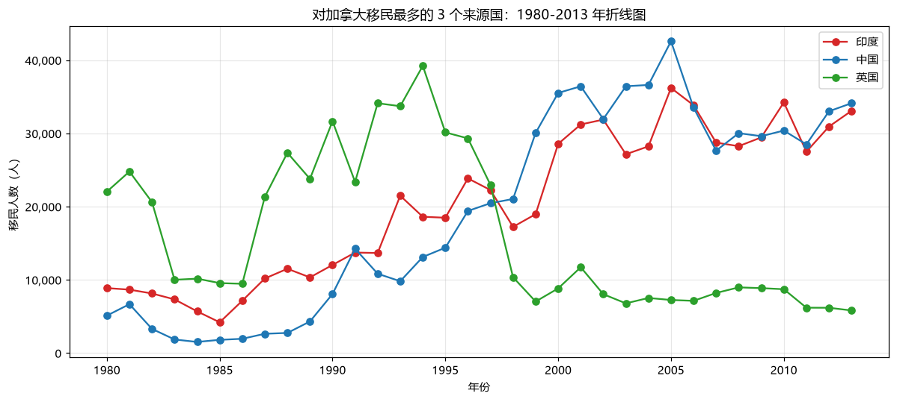
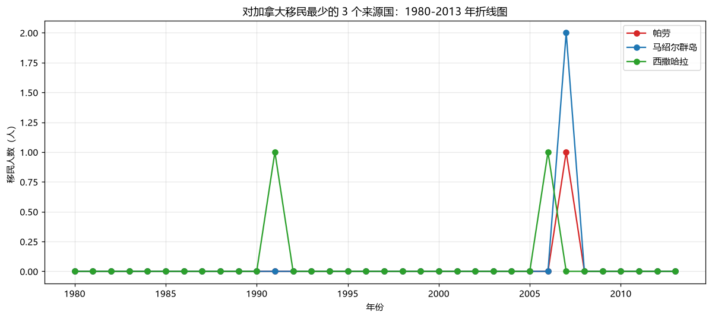
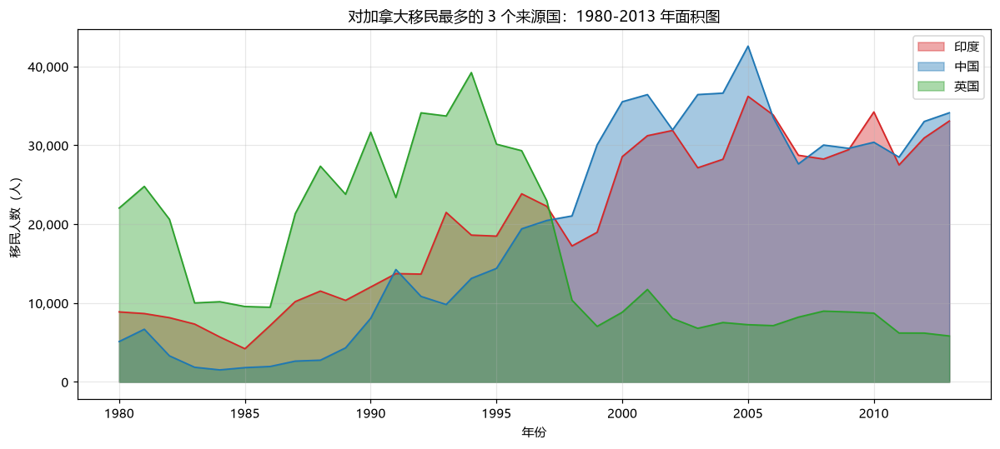
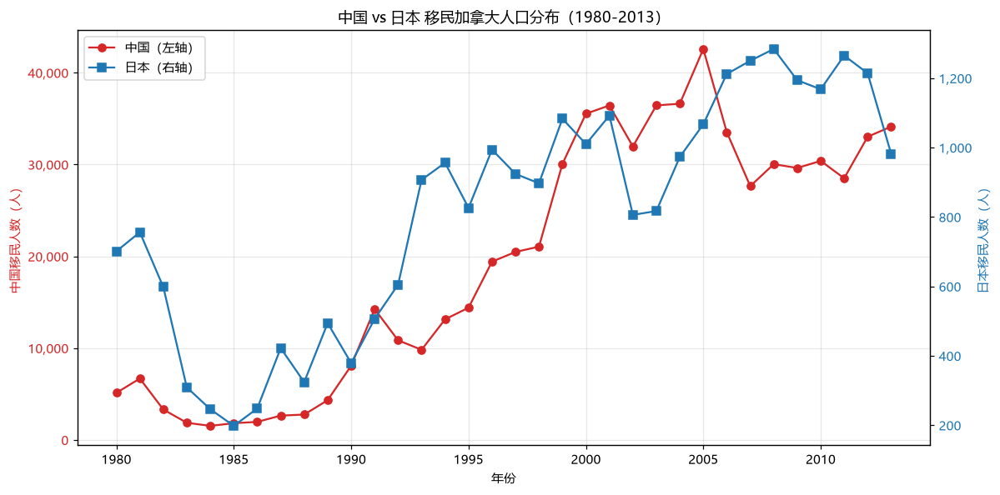
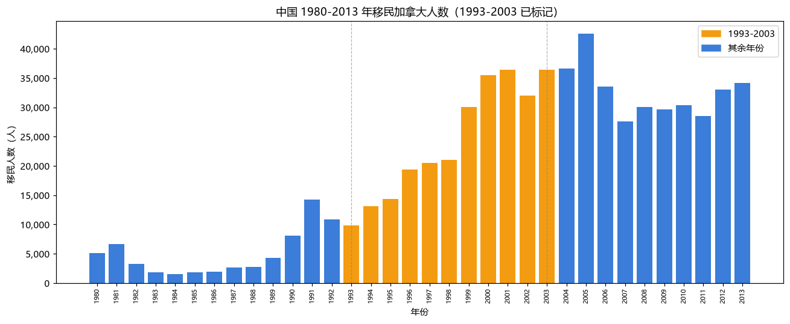
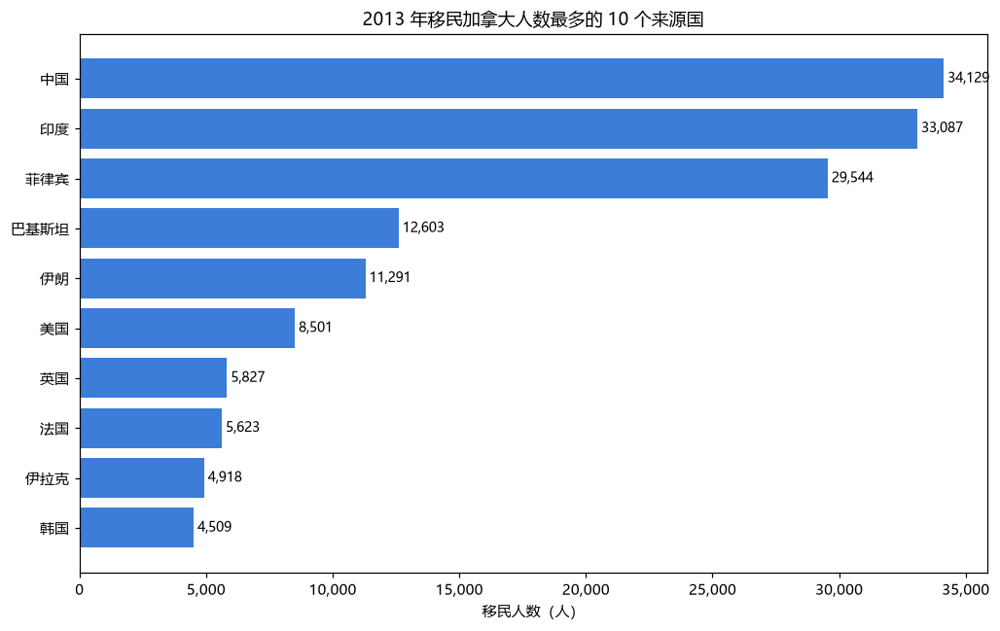

# 实验二：图像模型选择

> 分析对象延续实验一：加拿大外来移民（Type=Immigrants，Coverage=Foreigners），1980—2013 年，按国籍口径。

## 一、任务 1：最多 / 最少来源国折线图与面积图（2.1）

### 1. 移民最多的 3 个国家

**指标选择依据**：以 1980—2013 年累计移民人数作为"移民最多"的度量指标（简单、直观、口径一致）。累计最多的 3 国为：印度（691,904 人）、中国（659,962 人）、英国（551,500 人）。

**变化情况**：
- **印度**：1980 年约 8,880 人，此后稳步攀升，2005 年前后见顶，2013 年仍高达 33,087 人，是全程最稳定的高增长来源国。
- **中国**：1980 年仅 5,123 人，90 年代中后期开始陡增，2000—2010 年长期位居第一，2013 年达 34,129 人，超过印度成为当年最大来源国。
- **英国**：起点最高（1980 年 22,045 人），90 年代仍是大头，但 00 年代后持续下滑，2013 年仅 5,827 人，与中印走势相反。

### 2. 移民最少的 3 个国家

累计最少（非零）的 3 国为：帕劳（1 人）、马绍尔群岛（2 人）、西撒哈拉（2 人）。三者在 34 年间移民人数几乎始终为 0，仅在个别年份出现个位数记录。

### 3. 面积图

**面积图 vs 折线图优劣**：折线图强调时间趋势与变化斜率，适合精确比较多个序列的走势；面积图用颜色填充强化了"数量体量"的视觉感知，能更直观地看出三国的总体规模与彼此差距，但多个面积叠加会相互遮挡、不利于精确读数。二者互补，趋势分析用折线图，规模感知用面积图。

**思考：多与少哪个方向更有意义？**
"移民最多"的方向更有意义。理由：少数头部来源国贡献了加拿大绝大部分移民，决定了移民总量的规模、结构与趋势，是政策与社会经济分析的关键；而"移民最少"的国家数值接近 0、受统计噪声影响大，对整体结构几乎无解释力，除非专门研究特定小群体的迁移史。

## 二、任务 2：中国与日本移民分布对比（2.2）

**图形与刻度处理**：中日规模相差约 24 倍（累计中国 659,962 人 vs 日本 27,707 人），若共用同一 y 轴，日本曲线将贴底不可读。因此采用双 y 轴：左轴为中国（单位：人），右轴为日本（单位：人），各自调整刻度最大值，使两条曲线的分布形态都能清晰呈现。

**分析结果**：
1. 两国移民人数都随时间上升，但**中国体量远大于日本**；
2. **中国**呈"先平后陡"形态：80 年代低位（约 5,000 人），90 年代起快速增长，2003 年达峰值 36,439 人，之后高位波动，2013 年 34,129 人；
3. **日本**长期处于低位（每年数百人），2000 年后缓慢抬升至 2013 年的 982 人，整体平稳、无明显爆发。
4. 结论：在东亚来源中，中国是加拿大移民的主力，日本贡献甚微；两国迁移趋势的差异反映出各自经济阶段、人口流动模式与移民政策的不同。

## 三、任务 3：中国移民人数柱状图与标记（2.3）

**图形处理**：将 1993—2003 年的柱子用橙色高亮，其余年份用蓝色，并辅以灰色虚线分隔，直观标出关键区间。

**分析**：1980—1992 年中国移民人数在低位缓慢增长（1993 年为 9,817 人）；1993—2003 年是**快速增长期**，到 2003 年攀升至 36,439 人，十年增长约 2.7 倍；2004 年后进入高位平台期，2013 年为 34,129 人。这一加速期与 90 年代中国经济开放深化、留学与技术人员跨国流动增加，以及加拿大移民政策向技术移民倾斜的背景相吻合。

## 四、任务 4：2013 年移民前 10 国水平条形图（2.4）

**图形处理**：水平条形图按数值升序自下而上排列，最大值（中国）位于顶部，柱末标注具体人数，便于逐项比较。

**与实验一任务 2（1.5）对比分析**：
- 实验一 1.5 的分组柱状图看的是 1980—2013 年**累计前 5** 国的**年代结构**；本图看的是 **2013 单一年份前 10** 的截面排名。
- 两图相互印证又揭示变化：累计前三（印度、中国、英国）中，**印度、中国**在 2013 年仍居前两位，地位稳固；而**英国**在 2013 年仅排第 7（5,827 人），被菲律宾、巴基斯坦、伊朗超越，印证了欧洲传统来源国的相对衰落。
- 2013 年前 10 中亚洲国家占 6 席（中国、印度、菲律宾、巴基斯坦、伊朗、韩国），再次确认亚洲主导、欧洲退居次要的移民来源新格局。