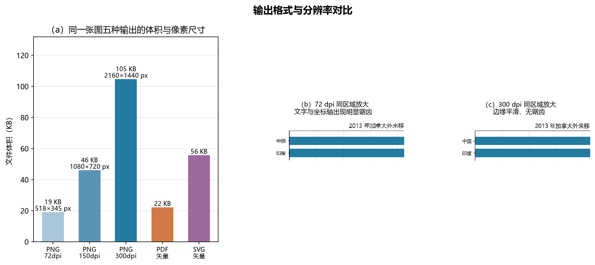
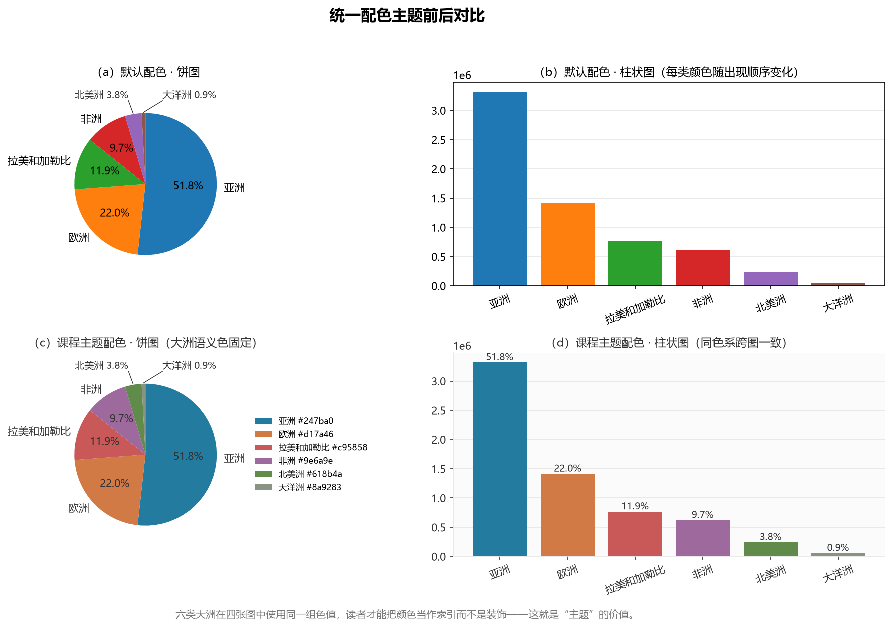
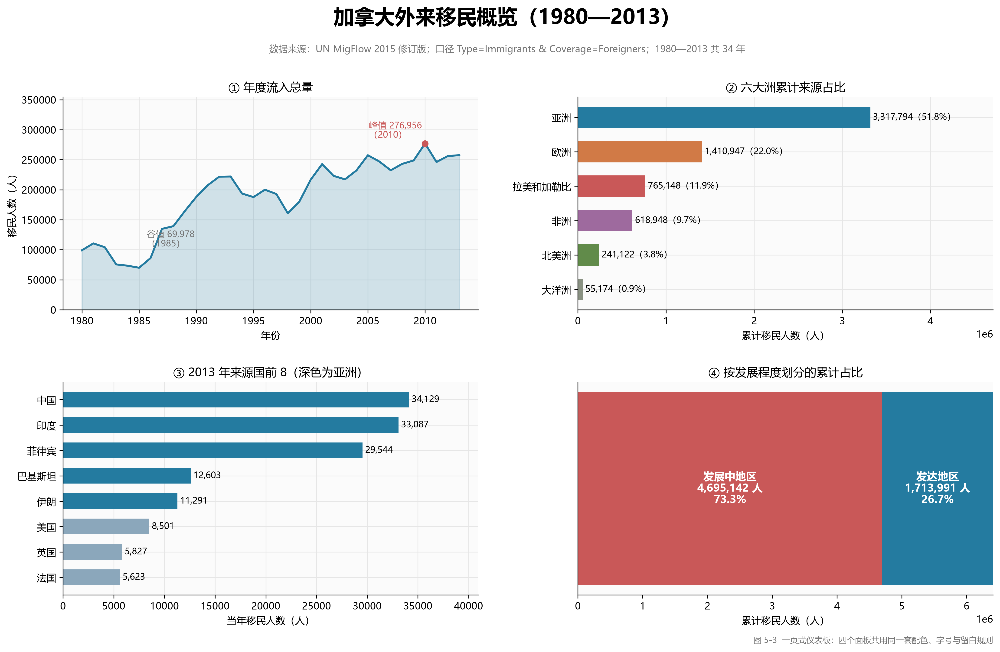
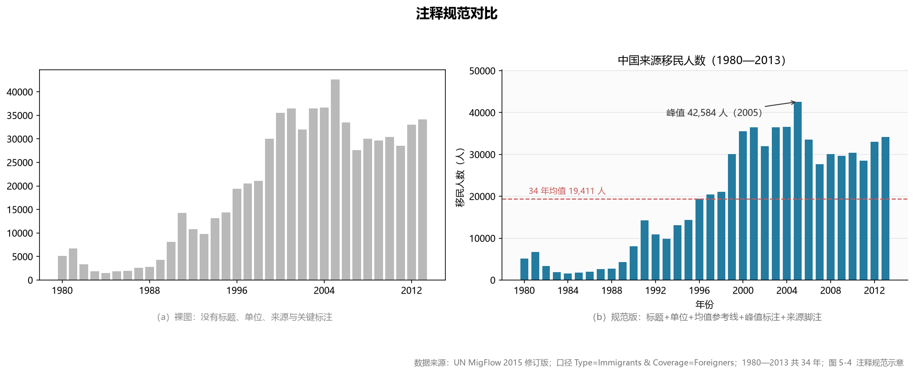
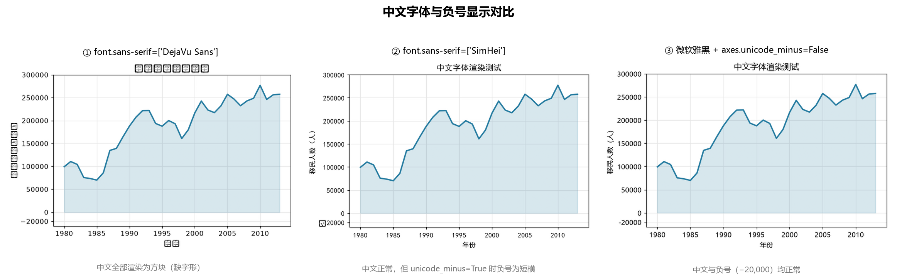

# 实验五：数据可视化输出

> 分析对象与实验一至四一致：加拿大外来移民（Type=Immigrants，Coverage=Foreigners），1980—2013 年共 34 年、194 个来源国、累计 6,409,133 人。本实验不引入新数据，处理的是「分析结果如何交付」——同样的结论，用不同的分辨率、配色、版式、注释和字体呈现，可用性差别很大。

## 一、任务 1：输出格式与分辨率（5.1）

### 1. 同一张图的五种输出

以「2013 年加拿大外来移民前 10 来源国」为基准图（中国 34,129 人、印度 33,087 人、菲律宾 29,544 人……），分别导出：

| 文件 | 格式 | 像素 | 体积 |
|---|---|---|---|
| `task1_72dpi.png` | 位图 PNG | 518×345 | 19.1 KB |
| `task1_150dpi.png` | 位图 PNG | 1080×720 | 46.0 KB |
| `task1_300dpi.png` | 位图 PNG | 2160×1440 | 104.6 KB |
| `task1.pdf` | 矢量 PDF | 任意放大 | 22.1 KB（内嵌字体） |
| `task1.svg` | 矢量 SVG | 任意放大 | 55.7 KB（文本可编辑） |

清单同时写入 `图/导出/导出清单.txt`，作为交付物的自检记录。

### 2. 位图与矢量的本质差别

- **位图**（PNG/JPG）是像素矩阵：72 dpi 只有 518 像素宽，放大后文字与坐标轴立刻出现锯齿（图 b）；300 dpi 是同区域 2160 像素，放大仍平滑（图 c）。
- **矢量**（PDF/SVG）存的是绘图指令：体积与画布尺寸无关，任意缩放不失真。PDF 适合打印与论文插图，SVG 适合网页与二次编辑（文字还能被搜索和改色）。
- 一个容易误判的点：**体积小不等于信息少**。PDF 只有 22 KB，却能描述同一张图并支持无损放大；72 dpi 的 PNG 19 KB 却不可用。判断标准是「目标场景需要多少像素/是否需要缩放」，不是文件大小。

### 3. 分辨率取值建议

| 场景 | 建议 | 理由 |
|---|---|---|
| 屏幕浏览 / PPT 内嵌 | 150 dpi | 1080 px 宽已覆盖常见屏宽，体积可控 |
| 实验报告 / 打印 | 300 dpi | 印刷标准，文字边缘不毛糙 |
| 需要放大、排版复用 | PDF / SVG | 尺寸无关，避免二次插值 |

因此本实验其余四张对比图统一用 150 dpi，需要印刷的仪表板用 300 dpi。

## 二、任务 2：统一配色主题（5.2）

**默认配色的问题**（上排）：matplotlib 的默认颜色循环按「类别出现顺序」分配，而不是按类别本身。同一个「亚洲」在饼图里是蓝色、在柱状图里可能变成橙色；一旦图超过 10 类，颜色自动循环复用，两类数据撞色。读者无法把颜色当成索引用，只能逐图读图例。

**课程主题的四条规则**（下排）：
1. **语义色固定**：六大洲各配一个固定色值（亚洲 `#247ba0`、欧洲 `#d17a46`、拉美 `#c95858`、非洲 `#9e6a9e`、北美 `#618b4a`、大洋洲 `#8a9283`），与实验一至四的配色保持同一套；
2. **中性底与网格**：背景 `#fbfbfb`、网格 `#e6e6e6`，让数据颜色成为画面里唯一的饱和色；
3. **去装饰边框**：隐藏上、右边框，只保留左、下轴线；
4. **统一字色与标注**：文字统一 `#333333`，关键占比直接标在图上，减少读图例的往返。

**效果**：同一份数据（亚洲 3,317,794 人 / 51.8%，欧洲 22.0%，拉美 11.9%，非洲 9.7%，北美 3.8%，大洋洲 0.9%）在两套规则下信息量相同，但下排的图可以脱离上下文单独阅读——颜色本身就编码了类别，跨图比较不需要重新对齐图例。

## 三、任务 3：一页式仪表板（5.3）

用 `GridSpec(2,2)` 把四个互补视角拼成一页：

| 面板 | 内容 | 关键读数 |
|---|---|---|
| ① 时序 | 年度流入总量 | 谷值 69,978（1985），峰值 276,956（2010），2013 年 257,535 |
| ② 结构 | 六大洲累计占比 | 亚洲 51.8%、欧洲 22.0%、拉美 11.9%、非洲 9.7%、北美 3.8%、大洋洲 0.9% |
| ③ 截面 | 2013 年前 8 来源国 | 中国 34,129、印度 33,087、菲律宾 29,544 |
| ④ 属性 | 发展中 vs 发达 | 发展中 4,695,142 人（73.3%）、发达 1,713,991 人（26.7%） |

**版式规则**：
- 一套配色贯穿四图，主色（亚洲蓝）留给最重要的时序面板，其余面板降饱和；
- 三级字号：总标题 21、面板标题 11、注释 9，读者一眼能分清层级；
- 统一留白：`hspace=0.34`、`wspace=0.24`，四图共享同一外边距；
- 一句话副标题交代口径（`Type=Immigrants & Coverage=Foreigners`）与来源，页脚放图注编号。

**代价**：面板变多后单图信息密度上升，必须靠标题层级和留白控制认知负荷，否则「一页看全」会变成「一页看不懂」。输出用 300 dpi，文件 494 KB，适合打印成单页 A4。

## 四、任务 4：注释规范（5.4）

同一张「中国来源移民人数」图，左为裸图、右为规范版。规范版补齐了五个要素：

1. **标题**讲清楚「主体 + 指标 + 时间范围」：中国来源移民人数（1980—2013）；
2. **单位**写在 y 轴：「移民人数（人）」；
3. **关键数值标注**：峰值 42,584 人（2005），用箭头指向对应柱；
4. **参考线**：34 年均值 19,411 人，虚线横贯全图，读者能判断某年高于还是低于常态；
5. **数据来源脚注 + 图注编号**（图 5-4），让图能脱离正文独立成立。

裸图的问题不在于「不好看」，而在于**不可复用**：脱离报告正文，读者不知道画的是哪个国家、什么单位、哪一年最高。实验一至四的图都按规范版标准出图，本任务是把这条隐性标准显式化。

## 五、任务 5：中文字体与负号（5.5）

三种配置的实测结果（本机字体覆盖情况用 `FT2Font.get_charmap()` 逐字验证）：

| 配置 | 中文字形 | U+2212（−） | U+FF0D（－） | 表现 |
|---|---|---|---|---|
| `DejaVu Sans` | 无 | 有 | 无 | 中文全部渲染成方块 |
| `SimHei` | 有 | **无** | 有 | 中文正常，负号靠后备字体替换 |
| `Microsoft YaHei` | 有 | 有 | 有 | 中文与负号均正常 |

**三个结论**：

1. **中文方块 = 字体缺字形**，不是编码错误。matplotlib 默认字体 DejaVu Sans 不含 CJK 字形，`font.sans-serif` 未配置或配置了不存在的字体时，中文一律变方块；
2. **负号是独立问题**。matplotlib 默认 `axes.unicode_minus=True`，负号用 U+2212。实测 **SimHei 不含 U+2212**，只有 U+FF0D，所以在只配置 SimHei 的环境里负号会显示为方块或空格；设 `axes.unicode_minus=False` 后改用 U+FF0D，SimHei 与雅黑都能正常显示；
3. **固定清单**：`plt.rcParams["font.sans-serif"] = ["Microsoft YaHei", "SimHei", "DejaVu Sans"]` + `plt.rcParams["axes.unicode_minus"] = False`。字体列表按「本机真实存在」排序并留 DejaVu 兜底，缺字时才有后备。

另有一个工程细节：字体是在 `savefig` **绘制阶段**解析的，用 `plt.rc_context()` 包住绘图语句并不能改变已保存图片的效果，所以本任务的做法是「每种配置先各自渲染成 PNG，再拼合对比」——这也正好对应「输出」这个主题：不同配置产出的是不同的文件。

## 六、小结

1. **格式由用途决定**：屏幕 150 dpi、印刷 300 dpi、需要缩放或二次排版交付 PDF/SVG；文件体积不能作为质量判据。
2. **配色要成为索引**：语义色固定 + 中性底 + 去边框，让颜色跨图可比；默认循环配色只适合一次性草图。
3. **版式靠规则而非手感**：GridSpec 定网格、三级字号定层级、统一留白定节奏，一页式仪表板才立得住。
4. **注释是可复用性的前提**：标题、单位、来源、关键标注、参考线五要素齐全，图才能脱离正文。
5. **字体与负号必须在交付前检查**：中文方块与负号方块是最常见的「本地正常、换机崩溃」事故，固定在 `rcParams` 里一次配置、全局生效。

**交付自检清单**：分辨率符合用途 → 配色与主题一致 → 标题层级清晰 → 五要素注释齐全 → 中文与负号显示正常 → 导出清单留档。
