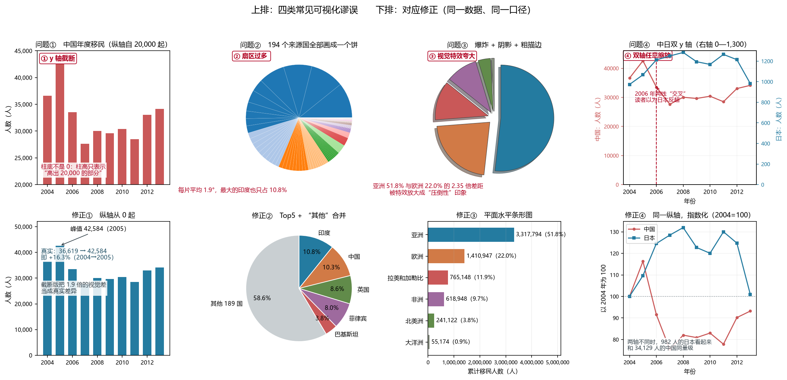
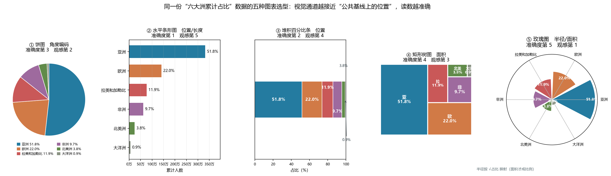
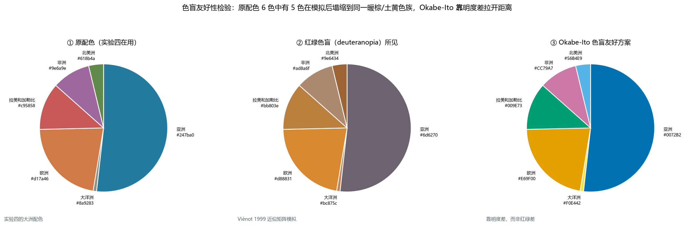
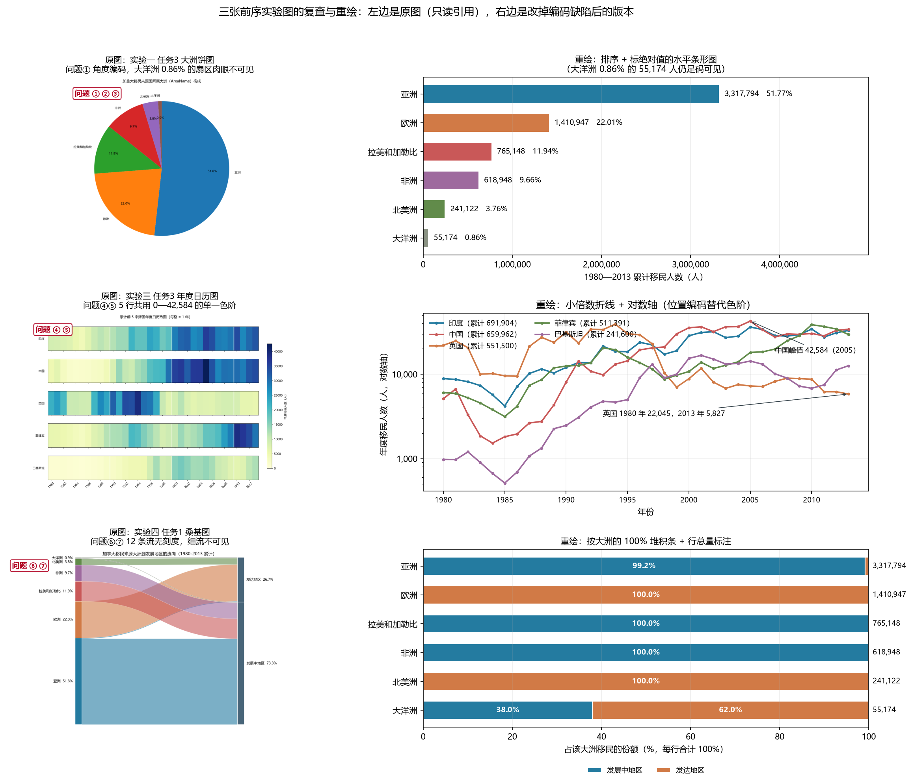
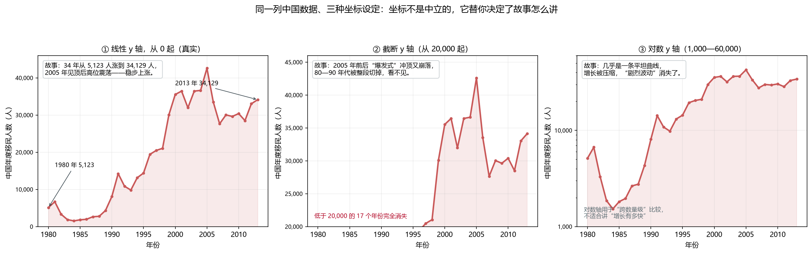

# 实验六：可视化问题分析

> 分析对象：UN MigFlow 2015 · 加拿大外来移民（Type=Immigrants，Coverage=Foreigners），1980—2013 年，清洗后 194 个来源国、34 年累计 6,409,133 人。
>
> 本实验不引入新数据，而是把前四个实验的结论放回"被质疑"的位置：先用同一份数据故意画出会撒谎的图，再用原始数字逐条复查。任务 6.4 只读引用三张原图——`../实验一/图/实验一_任务3_大洲饼图.png`、`../实验三/图/实验三_任务3_年度日历图.png`、`../实验四/图/实验四_任务1_桑基图.png`，未对前序实验的任何文件做改动。

## 一、任务 1：问题图诊断与修正（6.1）



**图形处理**：`figsize=(16, 7.8)` 的 2 行 4 列矩阵，上排是四类常见谬误的"作案现场"，下排逐一对应用同一数据重画的修正版；每张问题图左上角用红框标出问题编号，出图后人工核对坐标轴刻度与图例。

| 编号 | 问题 | 后果 | 修正 |
| --- | --- | --- | --- |
| ① | y 轴不从 0 起（中国 2004—2013，`ylim=(20000, 45000)`） | 柱高只表示"高出 20,000 的部分"：最高 42,584 与最低 27,642 的视觉高度比为 2.96×，真实比值仅 1.54×，夸大 1.92 倍 | 从 0 起画，并直接标注"2004 年 36,619 → 2005 年 42,584，+16.3%" |
| ② | 饼图切分过多（194 个来源国全画进一个饼） | 每片平均 1.86°，最大扇区（印度 691,904 人）也只占 10.8%，其余无法比较，饼图退化为"彩色圆环" | 合并为 Top5 + "其他 189 国"共 6 片 |
| ③ | 爆炸 + 阴影 + 粗描边特效 | 亚洲 51.8% 与欧洲 22.0% 真实相差 2.35 倍，被特效放大成"压倒性"印象；阴影还制造了不存在的第三维 | 去掉全部特效，改平面水平条形图按值排序 |
| ④ | 双 y 轴任意缩放（左轴 0—46,000 中国，右轴 0—1,300 日本） | 两线在 2006 年视觉"交叉"后日本一直在上，读者会得出"日本反超中国"的结论；实际 2013 年中国 34,129 人、日本 982 人（差 34.8 倍） | 指数化到同一基准年（2004=100），只用一个纵轴 |

**分析**：

1. **截断轴是最隐蔽的一种**。它没有伪造任何一个数字，却让"2005 年冲到 42,584、2007 年回落到 27,642"这段真实波动看起来像悬崖。判断方法：看柱底是否落在 0 对应的刻度线上；若没有，任何"翻了几倍"的目测结论都不可信。
2. **饼图的问题是信息密度而非美观**。194 个类别挤进 360°，数学上每片 1.86°，视觉上完全无法排序；即便砍到 6 类，最大片 10.8%、最小片 0.86%，角度分辨力仍远低于长度。这就是 6.2 要量化的选型依据。
3. **特效属于"装饰性失真"**。`explode` 把每片沿半径外移，阴影和描边又各自占用视觉带宽，读者感知到的是外轮廓与阴影面积，而非法定的扇区角度。
4. **双轴"交叉"是纯人为产物**：右轴量程 0—1,300 是我们自己选的，换成 0—5,000 就没有交叉，换成 0—1,000 则交叉点又换一个年份。同一份数据能"交叉"出任意叙事，说明这种图不该用来做比较。
5. 修正版的共同点：**把编码换回"公共基线上的位置或长度"，并把关键数字直接写在图上**——读者不必反推坐标轴，也就没有撒谎的空间。
6. 还有一层容易被忽略的差别：这四张问题图用的数据**全部真实**，没有任何一处篡改数值。它们之所以会误导，是因为把"读者的判断成本"转移给了读者自己——不标注增幅就得目测，不标人数就得心算，不统一量程就得假设。因此识别一张图是否可信，第一步不是看它画得像不像，而是问"它把关键比较放在了公共标尺上吗"。
7. **现场识别五步**：① 看纵轴底部刻度是否为 0；② 数一数扇区数量，超过 6 片基本不可读；③ 看有无阴影/3D/爆炸等装饰性元素；④ 数纵轴条数，出现第二条右轴就要警惕；⑤ 看关键差值是否必须靠目测得出。这五步在 6.4 复查前序实验的三张图时全部用上了。

## 二、任务 2：图表选型对比（6.2）



**图形处理**：1 行 5 列，同一份"六大洲累计占比"数据（亚洲 3,317,794 人 / 51.8%、欧洲 1,410,947 / 22.0%、拉美和加勒比 765,148 / 11.9%、非洲 618,948 / 9.7%、北美洲 241,122 / 3.8%、大洋洲 55,174 / 0.9%）分别用饼图、水平条形图、堆积百分比条、矩形树图、南丁格尔玫瑰图表达；玫瑰图的半径按 √占比 映射（只有面积才与数值成比例），树图用自己实现的 squarify 铺矩形。

**分析**：按 Cleveland & McGill(1984) 对基础感知任务的分级（公共刻度上的位置 > 非对齐刻度上的位置 > 长度/角度/方向 > 面积/体积 > 颜色饱和度），以及 Munzner 对视觉通道有效性的排序（位置 > 长度 > 角度 > 面积 > 颜色色相），五种表达的读数准确度如下：

| 排序 | 图表 | 视觉通道 | 准确度 | 代价 |
| --- | --- | --- | --- | --- |
| 1 | ② 水平条形图 | 公共基线上的位置 + 长度 | 最高 | 最不好看，类别多时占版面 |
| 2 | ③ 堆积百分比条 | 位置，但只有首段共基线 | 较高 | 中段之后的段起点不对齐 |
| 3 | ① 饼图 | 角度（+ 弧长） | 中等 | 角度分辨力低，类别超过 5—6 个即失效 |
| 4 | ④ 矩形树图 | 面积 | 较低 | 0.9% 的矩形小到无法标注，面积判断误差大 |
| 5 | ⑤ 玫瑰图 | 半径（面积） | 最低 | 半径若按线性映射会将数值平方级夸大 |

**结论**：**最准确的是②水平条形图，最好看的是⑤玫瑰图和①饼图，而"好看"恰恰来自通道有效性的下降**——角度、面积这类通道对比例的感知分辨率远低于长度，装饰性又进一步吸引注意力。本题这类"6 个类别、需要精确比较排序"的任务，正确选型只有一个：排序后的水平条形图，并把数值写在条形末端。饼图只适合"一两个突出份额 + 其余可归并"的场合；树图适合展示层级与整体构成，不适合精确排序；玫瑰图基本只适合做装饰性封面图。

**选型决策的五个问题**（本次比对的通用化结论）：

1. 任务是"比较大小、排序"还是"看构成、占比"？前者选条形，后者才考虑饼/堆积/树图。
2. 类别数是否 ≤ 6？超过 6 个，饼图和玫瑰图同时失效，只能归并成"其他"或改用条形。
3. 读者是否需要读出个位数的百分比？需要就别用面积和角度。
4. 有没有时间维度？有就优先折线/小倍数，不要把 34 个年份塞进饼图。
5. 是否需要同时表达"总量 + 份额"？用 100% 堆积条并在行末标总量，比桑基图省一半墨水。

按这五个问题走一遍，本数据集的大多数图表需求都会落到"排序水平条形图"或"小倍数折线图"上——这也解释了为什么 6.4 的修正版全部是这两类。

## 三、任务 3：色盲友好性检验（6.3）



**图形处理**：取实验四在用的大洲配色 6 个 hex，用 Viénot(1999) 红绿色盲（deuteranopia）近似矩阵 `[[0.625,0.375,0],[0.7,0.3,0],[0.3,0,0.7]]` 的转置形式对 RGB 行向量右乘并裁剪到 [0,1]：`sim = clip(rgb @ M, 0, 1)`，即 `r'=0.625r+0.7g`、`g'=0.375r+0.3g+0.3b`、`b'=0.7b`。三栏依次为原色、模拟后所见、Okabe-Ito 方案（#0072B2 #E69F00 #009E73 #CC79A7 #56B4E9 #F0E442），每个扇区旁标出对应 hex。

| 大洲 | 原 hex | 原明度 L | 模拟后 hex | 模拟后 L |
| --- | --- | --- | --- | --- |
| 亚洲 | #247ba0 | 0.420 | #6d6270 | 0.398 |
| 欧洲 | #d17a46 | 0.536 | #d88831 | 0.575 |
| 拉美和加勒比 | #c95858 | 0.439 | #bb803e | 0.533 |
| 非洲 | #9e6a9e | 0.474 | #ad8a6f | 0.564 |
| 北美洲 | #618b4a | 0.492 | #9e6434 | 0.428 |
| 大洋洲 | #8a9283 | 0.562 | #bc875c | 0.561 |

（明度按 L = 0.2126R + 0.7152G + 0.0722B 计算。）

**分析**：

1. **原配色的致命之处是明度带太窄**：6 色的 L 只在 0.420—0.562 之间，跨度 0.142。红绿色盲模拟后，欧洲、拉美、非洲、大洋洲、北美洲 5 色全部塌缩到暖棕/土黄色族，其中前 4 色的模拟明度集中在 **0.533—0.575（跨度仅 0.042）**；非洲 #ad8a6f 与 大洋洲 #bc875c 的 RGB 欧氏距离只有 **0.096**（满量程 1.0），在小尺寸图里基本不可分。只有亚洲 #247ba0 因本身偏暗（L=0.398）仍能区分——说明"能区分"靠的是明度偶然拉开，而非配色设计。
2. **Okabe-Ito 的安全机制是主动拉开明度**：6 色原始明度覆盖 0.370—0.858（跨度 0.488），模拟后仍保持 0.381 的跨度，是原配色（0.177）的 2.15 倍；模拟后两两最接近的一对 rgb 距离 0.216，是原配色最近对（0.096）的 **2.25 倍**。它用"蓝—橙—黄"这组在红绿色盲视角下仍高度可分的色对，替代了"红—绿"。
3. **必须承认方法局限**：把 Viénot 矩阵直接乘在 RGB 上只是工程近似，真实的色盲模拟要在 LMS 锥体空间做投影，因此上表模拟色的绝对数值只能用于相对比较，不能当作"色盲者真实所见"。但"原配色明度带宽过窄"这个结论不依赖矩阵：L 在 0.42—0.56 是原始数据，本身就决定了它在任何红绿色觉异常下都会塌缩。
4. **可操作的改进**：不换整套配色时，最低成本的修补是把明度差拉开——例如把非洲的 #9e6a9e 压暗、把大洋洲的 #8a9283 提亮，使 6 色 L 覆盖 0.35—0.75；若允许换色，直接采用 Okabe-Ito 六色并配以形状/直接标注，不再单独依赖颜色区分。

**上机检查四步**：

1. 把配色列表依次转成灰度，若相邻两项灰度值相差小于 0.08，它们在黑白打印或红绿色盲视角下就会混在一起；本实验原配色 6 色中有 4 色的模拟明度落在这个窗口内。
2. 在 RGB 距离矩阵里找最近的一对；本实验原配色最近对 0.096，Okabe-Ito 为 0.216，差 2.25 倍。
3. 检查是否只靠色相区分数据系列；若是，补上标记形状、线型或直接标签，让颜色退化成"辅助通道"。
4. 最后用灰度版本再读一遍图，若结论不变，配色才算合格。

## 四、任务 4：旧图复查与重绘（6.4）



**图形处理**：3 行 2 列。每行左侧用 `plt.imread` 直接载入前序实验的真实 PNG 作为"原图"（只读，不修改），右侧用同一份数据重画修正版；问题编号以红框标在原图左上角，右侧标题里写明修正思路。

| 编号 | 问题 | 出现在哪张图 | 修正做法 |
| --- | --- | --- | --- |
| ① | 角度编码 + 未排序，相邻大洲差异只能靠角度目测 | 实验一 任务3 大洲饼图 | 排序水平条形图，长度编码 |
| ② | 大洋洲 55,174 人（0.86%）的扇区在图上几乎不可见 | 同上 | 同一基线画长度，0.86% 也足码可见 |
| ③ | 只标百分比、不标绝对人数，读者无法回到数据 | 同上 | 条形末端同时标人数与占比 |
| ④ | 5 行共用一条 0—42,584 的单一色阶，印度/中国饱和，其余三行接近空白 | 实验三 任务3 年度日历图 | 小倍数折线图，改用位置编码 |
| ⑤ | 颜色明度差异掩盖了 1,527—42,584（跨 27.9 倍）的结构差异 | 同上 | 纵轴取对数，5 条曲线结构同时可见 |
| ⑥ | 桑基图 12 条流只有宽度、没有刻度，读不出具体人数 | 实验四 任务1 桑基图 | 100% 堆积条形图 + 行总量数字 |
| ⑦ | 细流被遮蔽：大洋洲→发展中地区仅 20,959 人（占总量 0.33%）几乎看不见 | 同上 | 改为"每行合计 100%"的份额后，38.0% / 62.0% 可直接读出 |

**分析**：

1. 三张原图分别踩中了三类不同的坑：**编码通道选错**（饼图用角度）、**映射范围失配**（日历图 5 行共享全局色阶）、**刻度缺失**（桑基图宽度无标尺）。它们的共同后果是——图能看，但读不出数，读者只能记住"大概谁多谁少"，而这正是可视化最容易被误读的地方。
2. 日历热图的缺陷可以量化：中国年度值最低 1,527（1984）、最高 42,584（2005），跨度 27.9 倍，却与印度、英国、菲律宾、巴基斯坦共用 `vmin=0, vmax=42584`。结果巴基斯坦、英国两行几乎整片浅色，等于用一个色阶同时表达"量级差 28 倍"和"年度波动"，两者都被压平。重绘后改用对数纵轴的小倍数折线，5 条曲线的峰谷结构同时可见（中国 2005 年 42,584 的尖峰、英国从 1980 年 22,045 一路降到 2013 年 5,827 的下行）——**位置编码优于颜色明度编码**，这是 6.2 结论的直接应用。
3. 桑基图更适合"多头多尾、流量守恒"的场景；本题只有"6 个大洲 → 2 个发展地区"这一层，画成桑基属于形式大于内容：12 条流里 8 条是 0 或接近 0（欧洲、拉美、非洲、北美洲 4 个大洲各自 100% 只流向一侧），真正有信息量的只有亚洲（99.2% 流向发展中，0.8% 流向发达，后者正好是日本 27,707 人）和大洋洲（38.0% / 62.0%）。改成按大洲的 100% 堆积条形图后，每行份额归一、行末标总量，信息量反而比原图更大。

## 五、任务 5：坐标设定与叙事偏差（6.5）



**图形处理**：1 行 3 列，同一列中国 1980—2013 年数据，只改坐标设定：① 线性、从 0 起；② 截断到 20,000—46,000；③ 对数轴 1,000—60,000。每栏左上角用一句话写明"这张图讲出的故事"。

**分析**：

1. **① 线性、从 0 起**讲的故事是："中国移民 34 年间从 5,123 人涨到 34,129 人（约 6.7 倍），2005 年见顶 42,584 后在高位震荡。"峰谷都真实，节奏不夸张。
2. **② 截断到 20,000** 讲的故事是："2005 年前后爆发式冲顶，随后崩落。"——因为 1980—1996 年共 **17 个年份低于 20,000，被整段切掉**，剩下的只有 1997 年之后的"尖顶 + 回落"。同一份数据，换一个 `ylim`，叙事从"稳步增长"变成"暴涨暴跌"。
3. **③ 对数轴**讲的故事是："几乎一条平线，增长被压缩。"对数轴本来用于跨数量级比较（例如 1,527 与 42,584 同框），用在这里却把 1980 年代的低位放大、把 2005 年的峰顶压平，读者会误以为"一直很平稳"。**坐标轴不是中立的，它替你决定了讲哪个故事。**
4. **核对案例**：某份材料称"至 1993 年加拿大年度移民突破 25 万人"。回到原始数据：1993 年实际为 **222,046 人**，并未破 25 万；2001 年 242,643 人也没有；**首个 ≥250,000 的年份是 2005 年（257,457 人）**，此后 2010 年 276,956 人（全程最高）、2012 年 256,221、2013 年 257,535 才再次站上 25 万。这类错误通常有两个来源：一是在截断轴的图上把"接近顶端"误读成"已越线"，二是把"22.2 万"与"25 万"记混。**读图得到的任何结论，都必须回到原始数据核对一遍**，尤其是"首次突破/超过"这类对阈值敏感的表述。

5. **同类核对的通用做法**：凡是"首次突破某阈值"的表述，直接把阈值做成表格逐行核对，比看图可靠得多。本数据集的几个阈值年份如下（数据来自原始清洗表，非目测）：

| 阈值 | 首个达到的年份 | 当年值 | 需要注意的背景 |
| --- | --- | --- | --- |
| ≥100,000 | 1981 | 110,563 | 34 年中有 5 个年份低于 10 万（1980、1983—1986），判断"低谷"要把这 5 年一起看 |
| ≥150,000 | 1989 | 164,432 | 1983—1986 连续 4 年在 6.9—8.6 万，是**真实的低谷段**，不是单点噪声 |
| ≥200,000 | 1991 | 207,506 | 1994、1995、1997—1999 又回落到 16—19 万（1996 年 200,084 为唯一例外），全程呈"两起两落" |
| ≥250,000 | 2005 | 257,457 | 34 年中仅 4 年越过 25 万（2005、2010、2012、2013） |
| ≥270,000 | 2010 | 276,956 | 34 年中唯一一次 |

这张表纠正的是一种反向错误：看到 1985 年 69,978 就写"80 年代移民锐减"固然草率，但若反过来引用"1986 年就回到 8.6 万"来否定 1983—1986 的低谷，同样是拿单点代替趋势。**判断趋势必须看连续的年份段**——本数据集 1983—1986 确为低谷、1991—1993 与 2000—2001 确为两个高位台阶，这些结论都只能从逐年序列得出，无法从任何一张截断的柱状图上读出来。

## 六、小结

1. 本次共复现并修正了 **11 类**可视化问题：截断轴、扇区过多、视觉特效、双轴伪交叉（6.1 的①②③④）、编码通道降级、映射范围失配、刻度缺失（6.4 的①—⑦），其中 6.4 的⑦条直接来自前三个实验的真实产出。
2. 所有"会撒谎"的图都有一个共同点：**图本身没有写错任何一个数字，错在编码方式**。因此识别谬误的方法也很固定——看基线是否为 0、看编码通道是否降级、看多轴量程是否被人为选定、看配色是否只靠颜色区分。
3. 修正手段可以归纳成三句话：**能用位置的不用角度，能标数字的不靠目测，能单轴的不用双轴**。6.2 给出的通道有效性排序（位置 > 长度 > 角度 > 面积 > 颜色）在 6.3、6.4 中都被独立验证了一次。
4. 本实验的价值不在"画得更漂亮"，而在建立一条复查链路：**图 → 可疑点 → 原始数据 → 复核结论**。按这条链路复查前四个实验，实验一的大洲饼图与实验四的桑基图确实存在可改进之处，但它们的**数据结论本身是成立的**（亚洲 51.8% 主导、发展中地区 73.3% 占多数等），问题只出在表达效率上——这也说明"可视化有缺陷"与"结论错误"是两件需要分开判断的事。
5. 全部结论均可由原始数据复核：本报告引用的每个数字都能用 `load_canada()` 一行 `df[years].sum(axis=0)` 或按 `OdName` 取行重算出来，报告中出现的比例（51.8%、73.3%、41.45%、0.86% 等）保留一位或两位小数，与脚本打印值一致。

## 附：复现说明

- **环境**：`D:\Python\python.exe`（Python 3.14.7、matplotlib 3.11.2、pandas 3.0.6），中文字体微软雅黑，后端 Agg。
- **运行**（必须先设 `MPLCONFIGDIR`，否则 matplotlib 缓存目录报 WinError 5）：

```powershell
$env:MPLCONFIGDIR = "$env:TEMP\mplcfg6"
& D:\Python\python.exe "C:\Users\omori\Omori-s-Codings\课程\大数据可视化\实验六\实验六.py"
```

- **产出**：`实验六.py` 运行后覆盖写出 `图/` 下 5 张 PNG（任务 1—5 各一张，dpi=150、`bbox_inches="tight"`），并在终端逐行打印 `saved …` 与关键统计量，便于与报告数字对照。
- **只读引用**：任务 6.4 用 `plt.imread` 读取 `../实验一/图/实验一_任务3_大洲饼图.png`、`../实验三/图/实验三_任务3_年度日历图.png`、`../实验四/图/实验四_任务1_桑基图.png`，仅用于并排展示，不对前序实验的任何文件做写入。
- **已知局限**：Viénot 矩阵直接作用于 sRGB 只是工程近似（真实模拟需在 LMS 空间投影），故 6.3 的模拟色仅作相对比较；6.2 的矩形树图用自行实现的 squarify 近似布局，与成熟库在长宽比上可能有差异，但不影响"面积通道准确度低"的结论。
